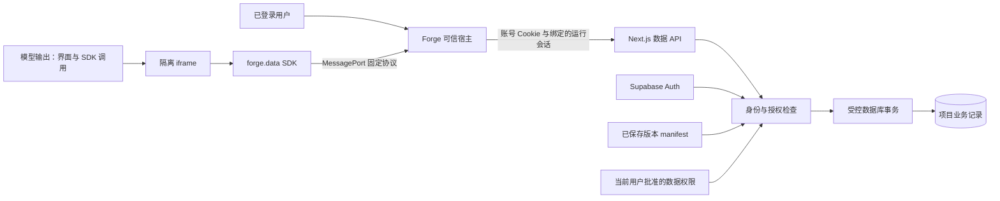

# Forge 正式账号、业务持久化与受限数据 SDK 设计

日期：2026-10-13（Asia/Shanghai）。状态：下一阶段的设计提案，尚未实现或部署。当前运行行为仍以 README、ARCHITECTURE 和现有代码为准。

目标是让生成的 Todo、内容排期等小型工具能长期使用：注册后跨设备打开同一项目，刷新后保留记录，生成代码只能操作用户授予的数据。首期交付一个完整的 Todo 闭环，再扩展集合类型。

## 1. 设计决策与现有基础

采用 **Supabase Auth + 服务端账号会话 + principal 项目所有权 + 项目业务集合 + 受限 iframe SDK**。保留现有 Next.js Route Handler、数据库短事务、生成认领和版本快照架构。

| 当前基础 | 下一阶段变化 |
| --- | --- |
| `src/lib/projects/session.ts` 的签名匿名 UUID | 正式账号映射到稳定 principal；旧匿名身份只用于显式认领 |
| `src/lib/projects/demo-access.ts` 的共享访问账号 | 正式邮箱账号、确认邮件、登录、找回、设备退出 |
| `projects.owner_id` 和 RPC 所有者检查 | owner_id 继续表示 principal，API 与 RPC 检查状态和归属 |
| `versions` 保存完整代码 | 每个代码版本绑定不可变数据 manifest；业务记录独立存储 |
| `TaskSpec v1.data` 仅描述内存集合 | v2 区分数据需求与服务器绑定的数据能力 |
| `composePreview` 的隔离 iframe / CSP | 保留隔离，通过可信宿主桥接固定数据操作 |
| 生成 requestId、run_token 和数据库期限 | 数据写入另设 operationId、revision 和结果确认协议 |

首期只有项目所有者可运行真实数据应用。账号身份、建造者和应用运行者是三个概念；在当前工作区预览中运行者恰好是已登录所有者。将来分享或发布应用时，必须单独认证访问者，不能默认借用作者身份。

首期不引入协作、公开数据、实时订阅、任意 SQL、外部 API 或生成后端。先提供真实账号下的项目私有记录；这些扩展都需要单独的权限与产品设计。

## 2. 信任边界



每次请求的有效权限为：

`有效账号 ∩ 当前项目所有权 ∩ 当前批准的集合与字段权限 ∩ 已保存版本 manifest ∩ 当前运行模式`。

模型输出、TaskSpec、SDK 参数、iframe 消息均视为不可信输入。权限与身份从服务器上下文取得，不能接受请求中的 ownerId、userId、capabilities、数据库表名、URL 或 RPC 名。

服务密钥会绕过 RLS，因此本方案的授权依靠 API 和受控数据库函数的显式检查；不能把“开启 RLS”当成 service-role 请求的所有者保护。这一事实来自 [Supabase RLS 文档](https://supabase.com/docs/guides/database/postgres/row-level-security)。

## 3. 正式账号与会话

### 3.1 产品流程

首期使用邮箱和密码，启用邮箱确认。Supabase Auth 负责密码存储、认证、确认和恢复凭证，Forge 不另建密码表。正式邮件配置独立 SMTP；默认测试邮件服务不能作为正式送达保障。见 [Supabase 密码认证文档](https://supabase.com/docs/guides/auth/passwords)。

注册 → 确认邮箱 → 登录 → 创建或导入项目 → 运行真实数据应用。另一设备用同一账号登录后访问同一 principal 的项目。找回密码发送统一提示，不暴露邮箱是否注册；登录错误也统一呈现。账号首次建档使用 user_id 唯一约束和幂等事务。

新增 `FORGE_AUTH_MODE=demo|account`，独立于 `FORGE_DEPLOYMENT=local|public`。demo 保持现有演示行为；account 所有私有项目与数据操作要求正式账号，旧 demo Cookie 不能满足认证。配置不足时 account 拒绝服务，不自动降级。公开首页仍可浏览。

### 3.2 服务端会话

选择全服务端 BFF 会话：浏览器只持有随机 256-bit 不透明会话 Cookie，数据库保存其摘要。Supabase access/refresh token 加密保存于服务端会话表，按 key_id 支持加密密钥轮换，日志与错误响应不包含 token。Cookie 在 HTTPS 使用 `__Host-forge_account`、HttpOnly、Secure、Path=/、无 Domain、SameSite=Lax；loopback 开发使用独立名称。

这是本方案的自选 BFF 流程，不直接照搬需要浏览器读取 refresh token 的标准 SSR 客户端模式。所有刷新、退出及认证调用由 BFF 完成，浏览器不初始化 Supabase Auth 客户端。

`requireActor(request)` 查会话摘要、有效期、撤销状态与 principal 状态，在当前请求调用 Auth 服务验证用户并确认其 user_id 与会话绑定一致。用户客户端每个请求单独创建，服务端管理客户端不混入用户认证状态。身份缓存只在当前请求有效；Auth 不可用返回 503，避免退回匿名身份。

Supabase 区分签名/过期验证与向 Auth 服务读取当前用户；getUser 可检测 Auth 会话撤销，但这次网络检查不与后续业务提交原子执行。参见 [SSR 认证客户端](https://supabase.com/docs/guides/auth/server-side/creating-a-client) 和 [Auth 高级说明](https://supabase.com/docs/guides/auth/server-side/advanced-guide)。Forge 内立即撤销的边界是本地撤销事务提交：后续数据库操作在锁内重查 app_sessions.revoked_at 和 principal.auth_epoch。外部 Auth 撤销按每请求检测，不承诺阻断检查后已经授权的在途事务。

刷新使用跨进程短期 lease 按会话串行，外部 Auth 请求不放在持有 principal/project 行锁的长事务内。返回后以 token_revision、未撤销、未过期及 auth_epoch 匹配执行 CAS；失败则丢弃新 token，不创建新会话或清空撤销状态，防止迟到刷新复活已退出身份。不在多个请求之间共享可变认证客户端。若 provider 已轮换 refresh token 但新 token 无法可靠落库，不继续使用过期凭证，结束该会话并要求重新登录。会话绝对有效期建议 30 天，闲置期建议 7 天，作为服务端配置。

当前设备退出先在事务中撤销 app_session 和对应 runtime_sessions，再清 Cookie，最后撤销 provider 会话。全部设备退出先提升 principal.auth_epoch、撤销全部账号/运行会话，再调用 provider 全局退出。外部撤销失败不能恢复已撤销的 Forge 会话。有效密码恢复上下文先在本地事务撤销全部会话，再调用 provider 改密；外部失败也保持撤销，允许恢复流程重试，成功后要求重新登录。注销账号另设独立确认与数据删除流程。

### 3.3 接口与 CSRF

| 接口（拟新增） | 规则 |
| --- | --- |
| POST `/api/auth/register` | 邮箱/密码；持久限流；发送确认邮件 |
| POST `/api/auth/login` | 认证成功后建立服务端会话；轮换会话与 CSRF token |
| GET `/api/auth/me` | 返回用户展示信息和状态；不返回 Cookie/token/principal 密钥 |
| POST `/api/auth/logout` | scope=local 或 all；先撤销本地权限 |
| POST `/api/auth/recovery` | 统一响应；发送一次性恢复凭证 |
| GET `/auth/callback` | 验证一次性 code、受支持的流类型与绑定 state/PKCE |
| POST `/api/auth/reset-password` | 仅有效恢复流程可用；之后撤销旧会话 |
| POST `/api/auth/claim-guest` | 已确认账号 + 旧匿名 Cookie + claimRequestId |

所有 Cookie 驱动的写接口要求固定 `FORGE_APP_ORIGIN`、匹配 Origin、JSON Content-Type 和绑定会话的 CSRF token。登录前也签发短期预认证 CSRF 上下文。不能使用任意 Host / forwarded header 推导可信来源，缺 Origin 的浏览器写请求拒绝。

callback 走独立的一次性凭证验证，不机械套用 JSON 写接口规则；回跳地址只能是服务器允许的站内路径。首次确认邮件跨设备打开时，可以完成邮箱确认，但没有原 state/PKCE 上下文则要求重新登录，不自动导入匿名项目。恢复凭证只进入恢复上下文，不直接授予项目与 SDK 权限。上线前实际验证确认、恢复和邮件扫描器预取行为。

### 3.4 身份表与匿名认领

| 表（拟新增，非可直接执行的 migration） | 主要字段 / 约束 |
| --- | --- |
| `principals` | id UUID PK；kind guest/account；user_id 唯一且 account 非空；status active/claimed/disabled；auth_epoch；created_at |
| `app_sessions` | id；token_hash 唯一；principal_id；user_id；auth_epoch；provider_session_id；encrypted_tokens；key_id；token_revision；refresh_lease_until；expires_at；last_seen_at；revoked_at |
| `anonymous_claims` | guest_principal_id 唯一；account_principal_id；claim_request_id 唯一；claimed_at；迁移数量，不存源码或业务内容 |

`projects.owner_id` 与 `deleted_project_attempts.owner_id` 指向 principals。迁移回填来源为两表 owner_id 的并集，保留原 UUID；owner_id=NULL 的私有遗留项目不分配给任何新账号。新 guest 签发也需建立 principal 记录。

账号登录后，可信宿主显示“导入此浏览器的 N 个旧项目”；用户选择后再认领。源身份只能从签名匿名 Cookie 读取，目标来自正式会话，body 不接受两个身份 ID。

认领事务共用现有 `pg_advisory_xact_lock(197608,1)`，锁源/目标 principal 与项目；存在未过期的生成/恢复则 409。事务内转移所有项目、删除后的额度历史，写认领账本，标记 guest=claimed。若之后已有业务记录或操作账本，也须保持其 actor/owner 引用一致；首期在开放数据功能前完成认领。

同一认领重复执行返回原结果；已被另一账号认领则拒绝。提交后清匿名 Cookie，所有入口继续拒绝 claimed guest，即使旧 Cookie 被重放或用户退出账号也不能重新获得旧项目。合并后的额度可超过当前阈值，此时等待窗口恢复，不能通过导入重置计数。Cookie 丢失的匿名数据没有自助认领路径。

## 4. 业务记录与 schema

业务数据属于项目，独立于 messages 和 versions。代码版本变化、Reload、重新登录不会清空业务数据；正式删除项目事务才级联删除其集合、记录、manifest、运行会话和操作账本。

### 4.1 数据模型

采用固定 PostgreSQL 表 + JSONB 记录。模型不能生成建表 SQL；服务器把受限集合 schema 编译为严格验证器，数据库写函数再次验证。

| 表（拟新增） | 字段 / 约束 |
| --- | --- |
| `private.data_collections` | id；project_id；稳定 name；active_schema_revision；当前权限 epoch；记录/字节计数；UNIQUE(project_id,name) |
| `private.data_schemas` | collection_id；revision；严格 schema JSON；hash；created_at；UNIQUE(collection_id,revision)，不可变 |
| `private.version_data_manifests` | version_id 唯一；project_id；manifest JSON；hash；sdk_version；创建后不可变 |
| `private.project_data_grants` | project_id；collection_id；批准的读写字段与操作；epoch；approved_by；approved_at；模型无写权限 |
| `private.data_records` | id；project_id；collection_id；data JSONB；schema_revision；revision BIGINT>0；created_by；created_at；updated_at；复合集合归属外键 |
| `private.runtime_sessions` | id；app_session_id；principal_id；project_id；version_id；manifest_hash；project_data_epoch；auth_epoch；mode；expires_at；revoked_at |
| `private.data_operations` | principal_id；project_id；collection_id；operation_id；request_hash；action；record_id；committed_revision；status；timestamps；UNIQUE(principal_id,project_id,operation_id) |
| `private.data_audit_events` | actor；project；collection；operation_id；action；result；时间；不存原始字段值 |

private schema 不加入 Data API exposed schemas。对业务表撤销 PUBLIC / anon / authenticated / service_role 直接读写权限，只授权受控函数执行。若使用 Data API，public 层提供 service-role-only 的固定 `SECURITY INVOKER` 包装函数，内部调用 private 的 `SECURITY DEFINER` 实现；固定空 search_path，并完整限定对象名。函数内逐项检查主体、项目、运行会话、manifest、字段和额度。函数授权细节见 [Supabase 数据库函数文档](https://supabase.com/docs/guides/database/functions)。

新 definer 使用专门的 NOLOGIN 数据执行角色，授予其必要的表权限与对应 RLS 策略，撤销所有新函数的默认 PUBLIC EXECUTE。grant 不给 service_role 继承执行角色；包装函数仅调用固定实现。所有 collection/schema/record/manifest 的复合外键同时约束 project_id，防止只校验单个 UUID 却串用其他项目。

runtime 的 app_session_id/principal_id 使用复合外键保证一致；manifest 与 version 的 project_id 也使用复合外键约束。account principal 的 user_id 引用 Auth 用户，但账号删除使用显式流程，不能意外级联抹掉项目；审计与注销保留策略单独处理。

这种权限布局减少误用表接口的风险，不能消除服务密钥本身的高权限；BFF 的认证上下文仍是信任根。后台维护客户端、认证客户端和数据访问封装分离，防止调用点遗漏授权条件。

`projects.data_epoch` 是项目级统一数据权限版本，任何集合 grant 变更都在项目事务内递增。runtime 绑定该值，申请、续期、读取、写入及提交均比较它；逐集合 epoch 只用于差异审阅，不能替代这个统一撤销屏障。

### 4.2 字段、查询与配额

首期沿用每项目总共最多 4 个持久集合、每集合最多 16 业务字段，不是每个 manifest 重新获得 4 个名额；类型为 text / number / boolean / date / enum。标识符沿用 TaskSpec 规则。严格拒绝额外字段、嵌套对象、危险原型键、非有限数字和类型隐式转换；系统 id/revision/createdAt/updatedAt 不能被业务字段覆盖。

建议初始服务端限制：text 最多 2000 字符；number 绝对值不超过 10^12 并支持 schema 范围；date 为有效 `YYYY-MM-DD`；enum 最多 12 个唯一值；单条规范化记录最多 16 KiB。optional 字段用省略表示未设置，v1 不支持 null；required 字段在 create 时必填或采用已批准 default。

list 支持最多 4 个经授权字段的等值 AND 过滤，按 createdAt + id 稳定分页；默认 25、最多 100 条，响应最多 256 KiB。cursor 为服务端签名的集合、schema、过滤条件与排序位置，不能跨项目复用。不承诺分页过程的跨页快照一致性；删除或并发新增后可重新加载。

建议每项目最多 2000 条 / 10 MiB 记录；每账号每分钟 60 次数据请求，其中写入最多 30 次，另设独立全局上限。配额是服务端配置，不能写进模型可调整参数。记录数/字节计数与写事务一起更新，账号限流跨进程持久保存，不复用付费模型的生成次数。list/get/status 和幂等重放都消耗请求限额，幂等命中只跳过重复业务写与记录/字节增量。上线后按真实负载调整这些提案值。

元数据也设 admission check：建议每项目最多 50000 个操作账本项、256 个 schema revision、1000 个数据 manifest、50 MiB 元数据；每账号最多 10 个活动账号会话，每项目最多 20 个活动 runtime。终结待确认操作预留受控账本空间，额度计数更新共用事务。新写入/生成在耗尽前拒绝，不能靠删幂等墓碑腾空间；只读与已有操作确认仍可用。会话过期后清理 token 密文与失效 runtime，审计按期限清理，schema/manifest 在仍被版本引用时不删除。记录额度、元数据额度和账号/全局请求额度分别统计。

### 4.3 schema 演进

集合 id 稳定；每个 schema revision 不可变。首期只自动接受新增 optional 字段；扩大 enum 是存储兼容变更，但不保证旧代码能理解新值，必须随适配后的新 App manifest 激活，旧枚举 manifest 的历史真实数据模式/Restore 拒绝并提示适配。不得默默丢弃新枚举记录来伪装兼容。不接受删除、改名、改类型、缩小 enum、新增 required 或收紧长度/数值范围。default 只用于后续 create，不暗中改写既有记录。

更新使用 patch，保留 manifest 未暴露的字段。旧版本读取只能得到其允许字段的投影；被撤销字段始终不可读。需要不兼容演进时，停止激活并显示明确冲突，另走有备份、预检、用户确认和回滚方案的迁移流程；模型不得自行执行 backfill/DDL。

## 5. 受限数据 SDK 与桥接

SDK 契约草案见 [sdk.d.ts](./designs/runtime-data-v1/sdk.d.ts)，Todo manifest 样例见 [manifest.example.json](./designs/runtime-data-v1/manifest.example.json)。两者为设计文件，不是已经注入预览的运行库。

### 5.1 公共接口

```javascript
async function start() {
  const tasks = forge.data.collection('tasks');
  const page = await tasks.list({ limit: 25, where: { done: false } });
  render(page.records);

  const ack = await tasks.create({ title: '准备演示', done: false });
  const saved = await tasks.get(ack.recordId);
  if (!saved) throw new Error('这条记录已被删除，请重新加载');
  renderSaved(saved);

  await tasks.update(saved.id, { done: true }, {
    expectedRevision: saved.revision
  });
  // remove 同样要求 expectedRevision；错误时按 operationId 查询结果。
}
start().catch(showError);
```

接口限定为 collection(name) 下的 list / get / create / update / remove / operationStatus。所有写入返回最小 ack（operationId、recordId、revision），随后 get 获取当前记录；重放 ack 不代表返回历史字段快照。SDK 自动生成 operationId，也允许调用方显式保留同一 UUID 用于重试。

SDK 不提供登录、用户信息、SQL、RPC、原始 fetch、事务脚本、批量删除或权限修改。collection name 由服务器版本 manifest 映射到稳定 id。读写字段分别授权；不能拿到可读字段就自动获得修改权限。

### 5.2 iframe 与 MessagePort

保留 `sandbox="allow-scripts"`、不加 allow-same-origin，CSP 继续 connect-src none，现有静态校验继续拦截常见网络、导航和存储 API。可信 bootstrap 在生成脚本前安装 SDK；不为 parent/fetch 放开静态校验。冻结 SDK 用于防止误改，不能把它当成安全隔离。

接真实记录前必须补齐数据出站验证。当前 sandbox 与 connect-src none 不能单独阻止 iframe 导航自身，动态构造导航可能把字段放入外部 URL；静态检查不能穷尽这些路径。这个边界见 [HTML sandbox 导航标准](https://html.spec.whatwg.org/multipage/browsers.html#sandboxed-navigation-browsing-context-flag)。

拟在可信父页面增加 HTTP CSP 的 frame-src 限制，评估 frame-src none 与 srcdoc 继承策略、Next.js 宿主策略的配合，再在支持浏览器中验证直跳、重定向、动态 DOM、资源提示和其他出站能力。策略设计依据 [CSP frame-src 与策略继承](https://www.w3.org/TR/CSP/#directive-frame-src)，具体浏览器阻断效果尚未验证，不作为已完成的保障。

首期只向经过审查的 App 版本授予最小业务字段，宿主的批准 UI 说明代码可处理这些字段；不能声称 schema 或 SDK 白名单证明代码用途安全。出站测试通过前不开放真实数据运行；高敏感数据需要可信声明式渲染器或受限解释器另行设计，不能直接交给任意生成原生 JS。

当前原生 iframe 仍不提供 CPU/内存隔离，MessagePort 和请求限额也不能阻止生成代码无限循环。继续保留运行错误、重载与停止入口；若要运行来源不可信的代码或承诺资源隔离，需要单独的执行环境设计。

初始化用独立 `forge-data-init` 通道，校验当前 iframe.contentWindow、每次 mount 的随机 nonce、严格消息格式及协议版本。沙箱 origin 为 null，不能仅按 origin 识别它，也不能把 nonce 当作权限凭证。

父窗口仅在初始化向这个已核对的 Window 使用 `targetOrigin='*'` 转移 MessagePort，不发送业务记录或认证材料；之后业务请求/响应只走绑定端口。iframe 向宿主发握手时使用配置中的精确宿主 origin。跨窗口消息的来源和结构校验依据 [MDN postMessage 文档](https://developer.mozilla.org/en-US/docs/Web/API/Window/postMessage)；opaque-origin iframe 的端口方案是本设计的具体取舍。

bootstrap 内部端口与请求表保存在闭包，生成代码只拿到 forge.data。生成代码与 bootstrap 同处一个 iframe，仍能恶意调用或干扰 SDK；服务端把每条请求重新校验。现有 ready/error 通道不能承载数据操作。

父窗口绑定 project/version/runtime session；SDK 消息只包含 protocol、requestId、action、collection、parameters，不接受扩张作用域的字段。消息仅允许有限 JSON 数据，拒绝其他 structured-clone 类型、额外 transferable、超大字段；建议每帧最多 4 个请求同时在途，单次 10 秒等待预算。宿主额外限流，数据库限额仍为最终约束。

### 5.3 运行会话与 API

| 接口（拟新增） | 规则 |
| --- | --- |
| POST `/api/projects/:id/runtime-sessions` | body={versionId,mode}；服务器核对版本归属、manifest、当前账号；返回宿主专用 handle 和有效期 |
| POST `/api/runtime/:sessionId/data` | 严格 action 联合类型；数据请求由宿主发出，自动附 Cookie / CSRF |
| GET `/api/projects/:id/data-operations/:operationId` | 已登录所有者查询最小操作状态；不要求原 iframe 仍存在 |
| POST `/api/projects/:id/data-operations/:operationId/resolve` | 可信宿主发起未知结果终结；项目锁内返回已有结果，或写永久取消墓碑阻止迟到执行 |
| POST `/api/projects/:id/data-plan/approve` | 可信宿主提交有 hash 的已展示 schema/权限提案，版本与 epoch 必须匹配 |
| POST `/api/runtime/:sessionId/revoke` | 关闭运行会话；端口关闭也是立即本地清理 |

runtime session 初始绝对期限 5 分钟；宿主到期前可重新认证、重新核对权限后换新会话。handle 不作为单独 bearer 权限，必须与同一有效 app_session、principal 和 epoch 一起验证。handle 保留在可信宿主，不向 iframe 传递账号凭证。

SDK 的 collection.operationStatus 只经 runtime data API，检查账本 collection_id 与当前集合、manifest/grant 一致。项目级 GET/resolve 是可信宿主恢复界面的所有者能力，不能直接暴露给 iframe，尤其 remove 后不能从已删除 record 反推集合归属。

每次数据库写入在提交事务内重查会话、归属、当前批准权限、manifest 和 latest version。HTTP 入口检查后权限可能变化，因此不能只检查一次。统一锁序为：需要时的全局限额锁/额度行 → 按 id 排序的 principal/账号额度 → app_session → project → runtime/collection/grant → operation → record。不需要全局锁的数据请求从 principal 开始，不能在后面逆序获取全局锁。刷新落库、当前/全设备退出、load/begin/advance/bind/finish/fail/restore/delete 也使用同一锁序及会话检查，避免死锁或迟到刷新/生成提交绕过撤销。

撤销提交之后才取得账号锁的请求失败；已先持锁并提交的操作属于撤销前有效操作。provider 验证在锁外进行，本地状态在锁内复核；不把外部网络请求留在数据事务中。

账号切换、退出、项目切换、版本提交、Restore、Reload 时关闭旧端口、取消等待并销毁旧运行会话。服务端再次校验保证其他标签页或失效宿主不能继续写入。

## 6. 写入一致性与恢复

写入参数含 operationId；update/remove 还含 expectedRevision。数据库在一次短事务内：校验账号与能力 → 检查幂等 key/hash → 验证字段 → 检查 revision 与配额 → 写记录/计数 → 保存最小 ack 与审计 → 提交。

request_hash 覆盖 principal、project、原版本/manifest、collection、action、参数与 expectedRevision，不包含临时 runtime handle。唯一 key 为 principal + project + operationId，换连接或进程仍生效。同 key 同参数重放原 ack；同 key 不同参数为 409 OPERATION_ID_CONFLICT。重放也需检查当前权限，不能通过操作账本读出已撤销的数据。

update/remove 只有匹配当前 revision 才执行，成功后 revision 增加。两个设备同时修改时一个成功、另一个返回 REVISION_CONFLICT，重新读取后由用户决定是否重试。remove 的 ack 携带删除后逻辑 revision，记录可物理删除，账本记录其提交结果。

账本不保存完整 payload 或业务记录快照，只保留 hash、collectionId、recordId、提交 revision 与结果。失败且确定未提交可保存最小失败结果；数据库无法确认时保持 unknown，不伪造失败。可清理详细错误，但幂等 key/hash/最小 ack 或拒绝码至少保留至项目删除，避免清理后旧请求重新生效。审计建议保留 30 天，账本墓碑单独计入受控存储预算。

SDK/宿主超时不代表写失败。错误包含 operationId 和 outcome=unknown；先查询状态或以原 operationId、原参数重试。状态 absent 也不证明原请求不会稍后到达，不能生成新 ID 重新创建同一记录。确定被拒绝的操作若要修改参数，必须作为新用户操作使用新 ID。

宿主在 sessionStorage 保存当前标签页的最小待确认信息（账号上下文标识、projectId、collectionId、operationId），不存记录值和认证材料；刷新后查询服务器账本。结果未知时显示“保存结果待确认”，不要显示已保存或默默回退内存。确认提交后再读取当前记录，记录可能已被其他设备继续修改或删除。

若刷新后丢失原参数且状态 absent，宿主使用 resolve 终结接口，在与 mutation 相同的项目/操作锁下等待在途事务：已有 applied/rejected 就返回；仍不存在则核对宿主提供的 collectionId 属于本项目，写 status=rejected、code=OPERATION_CANCELLED 的永久墓碑。取消墓碑允许 request_hash=NULL、action=cancel，任何后来使用这个 operationId 的参数都拒绝，不能再执行。这个事务屏障之后才可显示“确定未执行，可以重新操作”；若用户未登录或权限已撤销，无法完成屏障则保留 unknown，重新获得权限后再确认。

下表的 rejected 描述这次请求被拒绝。已有 pending operation 的最终结果只有账本证明或上述屏障才能判定；重试/查询返回 401/403/版本失效，不能证明原写未提交，宿主仍保留该 operation 的 unknown 状态，不能自动换 ID。

| 错误 | HTTP / SDK outcome | 用户恢复方式 |
| --- | --- | --- |
| AUTH_REQUIRED / SESSION_REVOKED | 401 / rejected | 登录后重新建立运行会话 |
| PROJECT_NOT_FOUND | 404 / rejected | 不存在和越权统一处理 |
| DATA_CAPABILITY_DENIED | 403 / rejected | 由宿主调整权限，模型不能自授 |
| RUNTIME_EXPIRED / VERSION_STALE / SCHEMA_INCOMPATIBLE | 409 / rejected | 回最新版本或重新建立兼容会话 |
| REVISION_CONFLICT / OPERATION_ID_CONFLICT | 409 / rejected | 读取现态；不能静默覆盖 |
| OPERATION_CANCELLED | 409 / rejected | 账本确认原 ID 不会再执行；新用户操作使用新 ID |
| INVALID_DATA | 422 / rejected | 修正字段，不能当作连接故障重试 |
| DATA_RATE_LIMIT / DATA_QUOTA_EXCEEDED | 429 / rejected | 等待窗口或管理数据 |
| DATA_UNAVAILABLE | 503 / rejected 或 unknown | 按执行是否可能提交区分；unknown 先查账本 |
| DATA_TIMEOUT | 504 / unknown | 用原 operationId 确认，不能新建重复写入 |

## 7. 生成契约、批准与原子激活

保持模型 App 输出 `title/html/css/javascript` 四字段。新增 TaskSpec v2 数据需求及服务器 GenerationDataContext；v1 仍按内存应用运行，不能给旧代码自动注入真实数据权限。

TaskSpec v2 的数据需求可以提出 schema，但不能授予权限。扩展规划输出版本，包含 steps 与有界 proposedData；服务器验证差异后，由可信宿主展示集合、字段、是否保存、允许新增/修改/删除及兼容性。用户确认后的 proposal hash/epoch 绑定当前项目、基线和生成 requestId，重试不能偷偷更换权限。

正常产品流程为：需求 → 具体规划与数据提案 → 宿主确认 → 代码生成 → 静态校验 → 原子保存代码版本、不可变 manifest 与兼容 schema 激活 → 真实数据运行。等待用户确认不能挂住现有 120 秒请求；拆成持久 data proposal 与后续生成请求，各自具有期限。确认后开启新的生成预算，原有单次最多 3 个模型调用约束需随规划复用策略明确更新并评测，不能暗中多次调用。

用户也可先在宿主定义集合，再直接生成。provider 获得已确认 schema、SDK 版本、允许操作和合成样例；不获得业务记录、账号 Cookie、密钥、完整用户资料或身份查询工具。规划/代码生成默认不读取真实数据。

provider 的现有“Use in-memory state only”指令在有数据上下文时换为固定 SDK 用法与错误处理；无上下文继续内存模式。static validation 增加 SDK 使用约束、禁止声明覆盖 forge，以及 collection/操作的常见非法用法；实际权限仍由桥/API/数据库执行，静态检查不能证明动态调用安全。

增加私有 manifest 校验器与版本化导出定义；生成工具 registry 只获得读取已批准 schema 和保存版本的能力，不增加任意业务读写工具。save_version 的事务同步检查 proposal hash、schema/grant epoch、基线、run_token、账号会话和原有固定期限；任何失败都不激活新 schema 或 manifest。

当前客户端的 GeneratedApp 仍是四字段；AppVersion 增加服务器的 runtime metadata，版本加载与状态接口按需要返回 sdkVersion、manifest hash 与运行模式，不把服务端会话材料塞入代码字段。

## 8. 历史版本、Restore 与删除

最新版本可按已批准 manifest 读写。新版本提交后，旧运行会话写入必须在数据库中被拒绝；跨标签页同样有效。并发边界以项目锁为准：先提交的旧写入属于合法旧版本操作，新版本提交后的旧写入失败。

历史预览默认使用可信宿主提供的合成数据，不能写入真实集合。用户可明确选择“查看当前真实数据”，服务器只授予当前权限与历史 manifest 交集的只读投影，界面说明这是当前记录，不是历史业务数据快照。

Restore 复制历史代码及 manifest，先验证对当前 schema 的兼容性，再追加新版本；当前权限被撤销的字段/操作不会被恢复。Restore 不降低 active_schema_revision、不回滚或清空 records。旧内存版本恢复后继续内存模式，真实集合仍保留；不兼容则 409，保留当前运行版本并引导生成适配代码。

删除项目复用现有确认与活动操作冲突规则，事务级联删除新增业务内容；应使用包括业务数据的明确提示。删除与数据写入使用相同项目锁，不能残留可用 runtime handle。现有 24 小时生成额度历史继续保留最小元数据；业务内容审计不以“限流记录”名义无限保存。

项目删除的最小事件另存全局审计表，使用不带项目外键的标识摘要、主体、时间、结果与保留期限，避免随业务表级联消失；不保留项目名、提示词、源码和记录字段。账号注销时按明确的保留策略清理或去标识化。

## 9. 实施分期与代码落点

迁移名为规划占位，实施时按仓库实际最新序号分配，不要把本文件当 SQL 执行。

| 阶段 | 主要改动 | 完成条件 |
| --- | --- | --- |
| A 正式身份 | `src/lib/auth/*`、`src/app/api/auth/*`、proxy/login；005 principals/sessions/claims；全部项目 API 从 requireSession 迁移 requireActor | 邮箱确认、找回、跨设备、匿名认领、撤销和原生成流程通过 |
| B 数据事务 | `src/lib/data/{schema,server,operations}.ts`；006 private 集合/schema/records/grants/ledger；service-only RPC | 数据真实持久化，越权、OCC、幂等、配额与故障验证通过 |
| C 运行桥 | `src/lib/preview/compose.ts`、新 SDK/bridge；runtime APIs；`app-builder.tsx` 运行生命周期 | 隔离 iframe 可用受控 Todo CRUD，刷新后读到已保存记录 |
| D 生成与激活 | TaskSpec v2、proposal 确认、provider/tools/run；007 manifest/原子 finish/restore 扩展 | 模型生成 Todo 可直接用 SDK，权限及 schema 变化可审阅 |
| E 发布验证 | 配置/邮件/清理任务/监测；README 与正式部署验收 | 独立测试环境完成全链路；实际迁移和发布单独执行 |

账号会话加密密钥、SMTP、正式 Auth URL/publishable key、固定应用 origin、CSRF secret 与原有 server key 分开配置。publishable key 用于服务端 Auth 调用也不授予业务表权限；服务密钥永不进入浏览器或生成代码。

生产启用前在独立 Supabase 环境迁移 001–004 与新迁移，验证回填数量、权限和认领；account + data 功能默认关闭，按阶段启用。回退功能开关只关闭数据运行，不删除正式数据或把正式项目降级为匿名可访问。持久清理不能依赖某次项目删除偶然触发。

## 10. 验收与可观测性

| 场景 | 必须满足的结果 |
| --- | --- |
| 注册、确认、找回、跨设备 | 稳定 principal；另一设备看到同一项目和 Todo；确认前不能调用私有数据 API |
| A/B 账号隔离 | B 猜到项目/记录/handle/operationId 也不能读取、写入、恢复或取得模型调用 |
| 匿名认领 | 额度与已删除项目账本合并；重放不重复迁移；另一账号及 claimed guest 均失去权限 |
| 认领与生成并发 | 活动生成时认领拒绝；事务失败不出现部分转移 |
| Todo 长期使用 | 新增、完成、删除真实写库；Reload/刷新/登出后再登录仍显示正确记录 |
| 恶意 SDK 消息 | 错 source/nonce/端口、跨项目、额外字段、越权字段、任意 SQL/URL、超大消息被拒绝 |
| 浏览器数据出站 | 真实浏览器验证自导航/重定向/动态资源等路径；不能依赖测试层统一拦截网络来证明生产策略有效 |
| 服务角色权限 | anon/authenticated 不能读表或执行 RPC；service_role 直接业务表路径拒绝；受控 RPC 越权输入被拒绝 |
| 并发与重试 | 同 operationId 只写一次；不同参数冲突；双设备同 revision 只有一个成功 |
| 提交后断网 | unknown 不虚报失败；刷新可确认同操作；absent 不诱导新 ID 重复写入 |
| 权限/身份变化 | 撤销、退出、账号切换、运行会话到期后，旧端口/旧标签页不能读写 |
| 退出与结果确认并发 | 刷新不能复活会话；原写已提交但查询被拒绝时保留 unknown，重新登录后确认 |
| 版本与 schema | 新版本后旧帧禁写；patch 不丢新增字段；不兼容 schema 不激活 |
| 历史与 Restore | 默认 fixture；真实历史预览只读并有说明；Restore 不改业务记录或恢复旧权限 |
| 删除/配额/清理 | 删除无孤立记录/handle；并发不能超额；清理不使已提交操作重新执行 |
| 元数据资源上限 | 更换 manifest 不绕过集合总额；操作/schema/会话数量受控；耗尽时旧操作确认仍可用 |

沿用 PGlite 测试实际 migration/RPC/事务，新增角色授权测试与真实浏览器 MessagePort 故障测试。PGlite 不能替代 Supabase Auth 邮件、刷新和撤销验证；后者在独立环境验收。生成行为评测增加 SDK 加载、CRUD、错误状态及连续修改后数据保留场景，使用隔离测试数据，不调用用户生产数据库。

记录 action、错误码、耗时、operationId、未知结果次数、修订冲突、授权拒绝、数据配额和会话刷新失败；不记录密码、token、Cookie、提示词、源码或业务字段内容。生成成本观测与数据运行观测分别计量。

首期最终验收链：账号 A 注册 → 生成并批准持久 Todo → 添加记录 → 刷新 → 设备 B 登录 A → 完成记录 → 恢复旧代码 → 数据仍在 → 账号 C 越权失败 → 写入断网后确认不重复 → A 退出后旧 iframe 请求失效。
